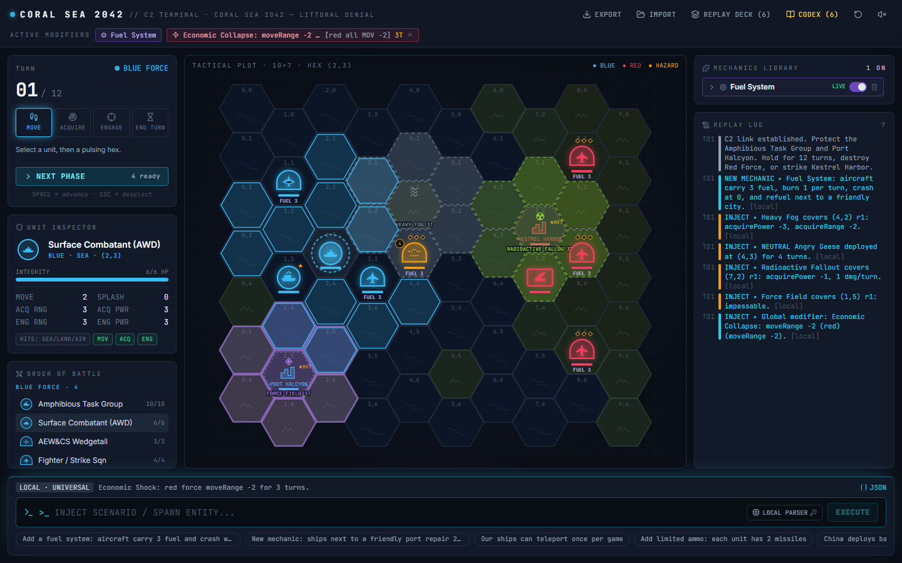
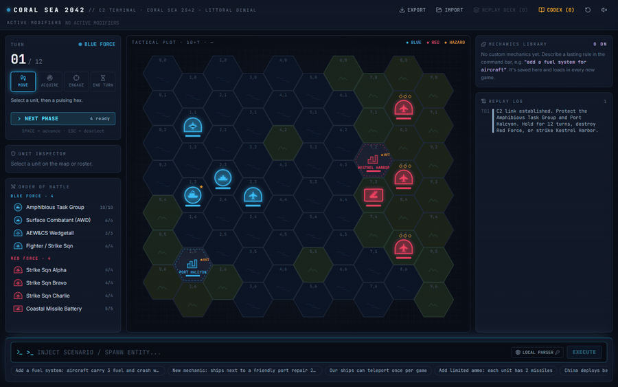
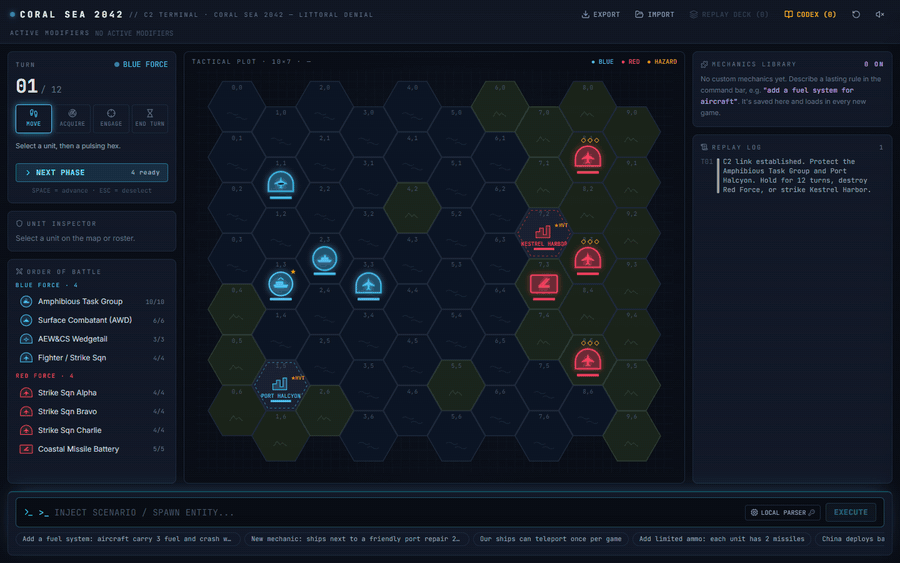
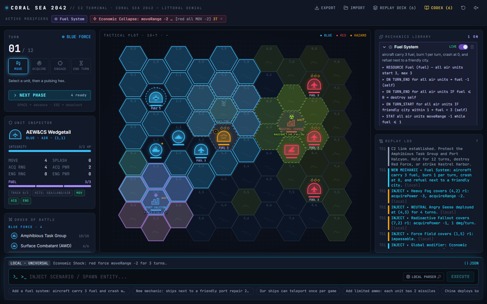
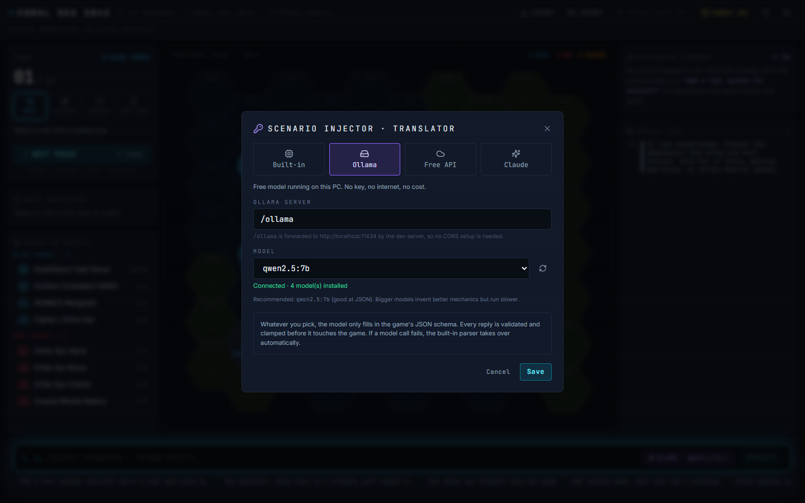
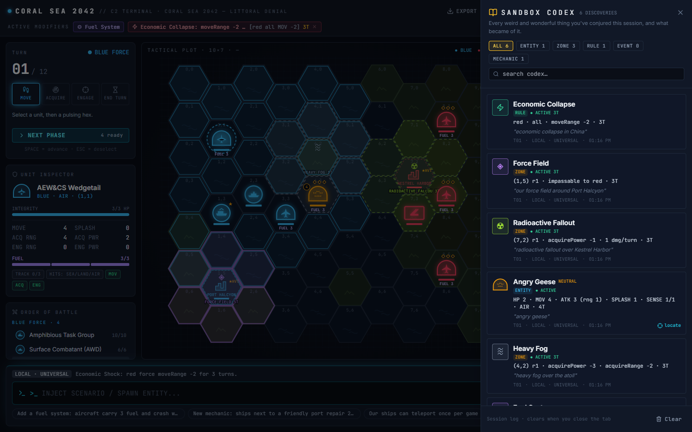
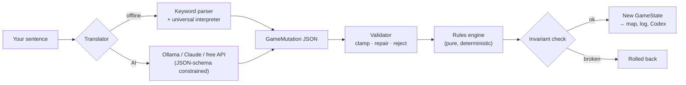

<div align="center">

# ⚓ CORAL SEA 2042 · C2 Terminal

**A hex-and-counter naval wargame where you can rewrite the scenario in plain English.**

Spawn anything, invent new rules, and fight a Red Force AI. Type *"angry geese"*, *"heavy fog over the atoll"* or *"add a fuel system"*, and it becomes part of the game.

[](https://github.com/anrricx/coral-sea-c2/actions/workflows/ci.yml)


### [▶ Play it in your browser](https://anrricx.github.io/coral-sea-c2/)



</div>

---

## What is this?

Analytical wargames like *Coral Sea 2042* are the board games defence planners use to test ideas: *can we protect a fleet from air attack?* or *does seeing the enemy first beat having bigger weapons?* This project turns that kind of game into a browser app, and adds one twist:

> **You can change the scenario at any moment by typing a sentence.**

An interpreter (built-in, or an AI model such as Ollama or Claude) turns your sentence into **strict, validated JSON**, and the game applies it live. The AI never writes code. It only fills in a form, and every value is checked and clamped before it touches the game.

<table>
<tr>
<td width="50%" valign="top">

**Play a turn**: move, spot, shoot, and watch Red respond.



</td>
<td width="50%" valign="top">

**Type anything**: geese, fog, orbital lasers, force fields.



</td>
</tr>
</table>

## Contents

- [Quick start](#-quick-start)
- [Tutorial: your first game](#-tutorial-your-first-game)
- [Reading the map](#-reading-the-map)
- [The Scenario Injector: type anything](#-the-scenario-injector-type-anything)
- [Inventing new mechanics](#-inventing-new-mechanics)
- [Choosing an AI translator](#-choosing-an-ai-translator)
- [Sandbox Codex, saving and replays](#-sandbox-codex-saving-and-replays)
- [Controls cheat sheet](#-controls-cheat-sheet)
- [How it works](#-how-it-works)
- [Development](#-development)

---

## 🚀 Quick start

**Option A: no install.** Open the [live version](https://anrricx.github.io/coral-sea-c2/). The built-in interpreter works offline. To use Ollama from the hosted page, see the [extra step](#using-ollama-with-the-hosted-version).

**Option B: run it locally** (requires [Node.js](https://nodejs.org) 20 or newer):

```bash
git clone https://github.com/anrricx/coral-sea-c2.git
cd coral-sea-c2
npm install
npm run dev          # → http://localhost:5173
```

---

## 🎓 Tutorial: your first game

### The goal

You command **Blue Force** (cyan). The computer commands **Red Force** (crimson).

| You win if… | You lose if… |
|---|---|
| your **Amphibious Task Group ★** survives 12 turns | the Amphibious Task Group is sunk |
| or you destroy every Red unit | or **Port Halcyon** (your city) falls |
| or you wreck **Kestrel Harbor** (Red's city) | |

### The one idea that matters: find it, then shoot it

You **can't shoot an aircraft until your sensors have tracked it**. Ships and ground units can be hit any time, but aircraft need **3 tracking points** first (shown as ◇◇◇ above them). Once they have 3, they show **CONFIRMED** and you can fire. Analysts call this the *kill chain*. It makes your radar plane and destroyer just as important as your fighters.

### Your forces

| Unit | Role |
|---|---|
| ⛴ **Amphibious Task Group ★** | The thing you must protect. Weak in a fight, so keep it back. |
| 🚢 **Destroyer (AWD)** | Your best unit. Its radar confirms an aircraft *by itself* (3 points), and it shoots 3 hexes away for 3 damage. |
| ✈ **AEW&CS radar plane** | Spots from 4 hexes away (2 points) but is unarmed. Keep it safe. |
| ✈ **Fighter squadron** | Spots a little (1 point) and shoots 2 hexes away for 2 damage. |

Red has three strike squadrons, which must get **right next to** a target to attack, plus a coastal missile battery with long range.

### Each turn has four phases

Press **Space** (or the button on the left) to move on to the next phase.

| Phase | What you do |
|---|---|
| **1 · MOVE** | Click a unit, then click a pulsing hex. Ships stay on water, aircraft fly anywhere. |
| **2 · ACQUIRE** | Click a unit with sensors, then an enemy aircraft with an **amber crosshair**. Each sensor adds tracking points. |
| **3 · ENGAGE** | Click a shooter, then a target with a **red crosshair**. Watch the explosion and the floating damage number. |
| **4 · END TURN** | Red moves, spots and attacks. Then tracking points reset, so you have to spot again every turn. |

### Walkthrough

1. **Turn 1 (get into position).** Red starts far away, so nothing can be shot yet.
   - Move the **destroyer** one or two hexes east, in front of the task group.
   - Keep the **task group** back near Port Halcyon (bottom left).
   - Park the **radar plane** and **fighter** near the destroyer, not out in front on their own.
   - Press Space three times to end the turn.
2. **Turn 2 (the kill chain).** Red's fighters close in.
   - In **ACQUIRE**, click the destroyer, then an enemy fighter: it's instantly **CONFIRMED**.
   - Click the radar plane (2 points) and then your fighter (+1) to confirm a **second** target.
   - In **ENGAGE**, shoot the confirmed fighters.
3. **The trick.** Red fighters must be *adjacent* to attack, but your destroyer hits from **3 hexes**. Make them fly through its range before they reach the task group.

> 💡 If you only ever press End Turn, Red sinks the task group in about three turns. You have to use the kill chain.

---

## 🗺 Reading the map

| You see | Meaning |
|---|---|
| Cyan / crimson / amber counters | Blue (you) / Red (AI) / wild hazards that attack everyone |
| Dome ◠ · circle ◯ · rectangle ▭ frame | Aircraft · ship · land unit |
| ◇◇◇ above an aircraft | Tracking points; three filled = **CONFIRMED** |
| Pulsing hexes | Where the selected unit can move |
| Amber / red crosshair | Something you can spot / something you can shoot |
| ★ | High-value target (protect yours, destroy theirs) |
| Small number badge on a counter | Turns left before that unit expires |
| `FUEL 3` under a counter | A custom resource from a mechanic |
| Tinted hex area with ≋ ☢ ϟ ◈ … | A zone (fog, radiation, storm, force field…). A solid border means impassable. |

The **Unit Inspector** (left) shows a selected unit's stats. When a modifier changes a stat, the base value is struck through and the new value is shown in green or red.

---

## 🪄 The Scenario Injector: type anything

The command bar at the bottom accepts **any** sentence. Click an example chip, or type your own and press **Enter**.

| You type | The game creates |
|---|---|
| `angry geese` | 🪿 A wild **unit**: a fast, aggressive flock with splash damage that attacks anything nearby |
| `alien mothership` · `a sleepy dragon made of cheese` | 👽 A **unit** with stats derived from the description |
| `heavy fog over the atoll` | ≋ A **zone**: sensors inside it are blinded |
| `radioactive fallout over Kestrel Harbor` | ☢ A **zone** that damages units inside it every turn |
| `our force field around Port Halcyon` | ◈ A **zone** Red can't enter |
| `economic collapse in China` | 📉 A **rule**: Red movement −2 for 3 turns |
| `our internet goes down` | 📡 A **rule**: Blue sensors −1 |
| `a laser beam from space hits the enemy battery` | 💥 An **event**: a pinpoint strike on that unit |
| `China deploys bat bombs at (6,4) that deal 3 splash damage` | Exact stats when you spell them out |

**How descriptions become stats:** *giant* or *armoured* means tough and slow, *fast* means more movement, *laser* or *artillery* means long range, *explosive* or *swarm* means splash damage, *cute* means harmless. Things that fly, swim or walk get the right domain. **Wild creatures** join the amber neutral side.

**Targeting:** you can aim at coordinates `(4,2)`, a city (*"Kestrel Harbor"*), a unit (*"the enemy battery"*), a side (*"near our fleet"*), a landmark (*"the atoll"*), or a direction (*"in the south"*). Typos and emoji work too: *"laser bean"*, 🐉, `🌊 at (3,5)`.

Click **JSON** in the command bar to see exactly what your sentence became.

---

## 🧩 Inventing new mechanics

Describe a lasting **rule** instead of a one-off event, and it becomes a permanent **mechanic**:

```text
Add a fuel system: aircraft carry 3 fuel and crash when they run out
New mechanic: ships next to a friendly port repair 2 HP each turn
Our ships can teleport once per game
Add limited ammo: each unit has 2 missiles
```



Mechanics are built from engine building blocks:
- **Resources** such as fuel, ammo or charges.
- **Triggers:** *at turn end, if fuel ≤ 0, destroy the unit*.
- **Stat rules:** *aircraft low on fuel move 1 less*.
- **Action rules:** *can't attack with no ammo*, *may teleport for 1 charge*.

They're saved to the **Mechanics Library** (right panel) and load into **every new game**. Switch them on or off, expand one to read its rules, or delete it. The Red AI has to obey them too.

---

## 🤖 Choosing an AI translator

Click the badge at the right of the command bar (**LOCAL PARSER 🔑**) to pick who interprets your sentences:



| Option | Cost | Best for |
|---|---|---|
| **Built-in** | Free, offline, instant | Everything in this README. It uses word lists, so very unusual nouns become generic units. |
| **Ollama** | Free, runs on your PC | Truly free-form prompts and inventing new mechanics. About 5–15 s per prompt with `qwen2.5:7b` on an 8 GB GPU. |
| **Free API** | Free tiers | OpenRouter `:free` models, Groq, or LM Studio. Paste the provider's key. |
| **Claude** | Paid API key | The most capable at inventing complex mechanics |

### Setting up Ollama (recommended free option)

1. Install [Ollama](https://ollama.com) and run `ollama pull qwen2.5:7b`.
2. Keep the Ollama app running.
3. In the game, open the translator settings, choose **Ollama**, and click **Save**. Installed models are detected automatically.

#### Using Ollama with the hosted version

Browsers only let a website talk to your local Ollama if Ollama allows that site. Run this once, then restart Ollama:

```powershell
# Windows (PowerShell)
setx OLLAMA_ORIGINS "https://anrricx.github.io"
```
```bash
# macOS / Linux
launchctl setenv OLLAMA_ORIGINS "https://anrricx.github.io"   # macOS
export OLLAMA_ORIGINS="https://anrricx.github.io"             # Linux (then restart: ollama serve)
```

When you run the game locally with `npm run dev`, none of this is needed.

> 🔐 API keys are stored only in your browser's `localStorage` and sent straight to the provider you chose. Nothing passes through any server of this project.

---

## 📖 Sandbox Codex, saving and replays



- **CODEX:** a drawer listing everything you've conjured this session. Each entry shows its stats, whether it's still active, destroyed, dissipated or expired, the prompt you typed, and which translator made it. Click **locate** to jump to a unit.
- **EXPORT:** downloads the whole match (state, log, every injected change, and your mechanics) as JSON.
- **IMPORT:** restores a saved match exactly. A file that contains only a scenario deck replays it onto a fresh map.
- **REPLAY DECK:** restarts the match with all of this session's injections applied again.

---

## ⌨ Controls cheat sheet

| Key / action | Does |
|---|---|
| **Space** | Next phase / end turn |
| **Esc** | Deselect |
| **/** | Jump to the command bar |
| **↑ / ↓** in the command bar | Previous prompts |
| Click a roster entry | Select that unit |
| 🔊 (top right) | Mute sound effects |
| ✕ on a modifier badge | Remove that modifier |

---

## 🔧 How it works



There are five kinds of change:

| Type | What it does |
|---|---|
| `SPAWN_UNIT` | Add a unit |
| `MODIFY_GLOBAL_RULE` | Change a stat for a whole side or domain |
| `TRIGGER_EVENT` | An instant strike, optionally changing terrain |
| `CREATE_ZONE` | A hazard covering specific hexes |
| `DEFINE_MECHANIC` | A permanent new rule |

**Safety by design:** the AI produces **data, never code**.
- **Limits:** every number is capped, there are at most 40 units and 12 zones, and coordinates must be on the map.
- **Rollback:** an invariant check undoes any change that would leave the board broken.
- **Crash guard:** an error boundary catches display errors and offers *Undo last injection*.
- **Fuzz test:** 400 random and hostile prompts, plus malformed model output, run on every push.

The **engine** is pure TypeScript with no React dependency and no randomness: every function takes a state and returns a new one. That makes matches reproducible and easy to test.

---

## 🛠 Development

```bash
npm run dev        # dev server with hot reload (also proxies /ollama → localhost:11434)
npm test           # 53 tests: engine rules, mechanics, sandbox interpreter, fuzzing
npm run build      # type-check + production build into dist/
```

```text
src/
├─ engine/              Pure game logic (no React)
│  ├─ types.ts          GameState, Unit, Zone, Mechanic, GameMutation…
│  ├─ engine.ts         Movement, acquire/engage, turn resolution, applyMutation
│  ├─ ai.ts             Red Force planner
│  ├─ mechanics.ts      Runtime for custom mechanics (triggers, effects, resources)
│  ├─ zones.ts          Area-hazard helpers
│  ├─ validate.ts       Validation, clamping, invariant checks
│  └─ hex.ts            Hex-grid maths
├─ ai/                  Sentence → GameMutation
│  ├─ localParser.ts    Precise keyword templates
│  ├─ universalParser.ts  "Type anything" interpreter (traits → stats)
│  ├─ mechanicPresets.ts  Offline mechanic templates
│  ├─ providers.ts      Ollama / OpenAI-compatible / Claude dispatch
│  └─ claudeParser.ts   JSON schema + system prompt
├─ components/          React UI (SVG hex map, panels, Codex, settings…)
└─ audio/sfx.ts         Synthesised Web Audio sound effects
tests/                  Vitest suites
```

Every push runs the tests and build ([CI](.github/workflows/ci.yml)), and deploys to GitHub Pages ([workflow](.github/workflows/pages.yml)).

---

<div align="center">

Inspired by analytical tabletop wargames such as *Coral Sea 2042*.<br>
Built with React · TypeScript · Tailwind · Vite · Vitest · [MIT licensed](LICENSE).

</div>
